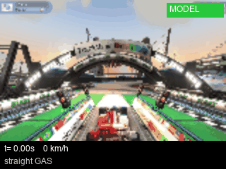
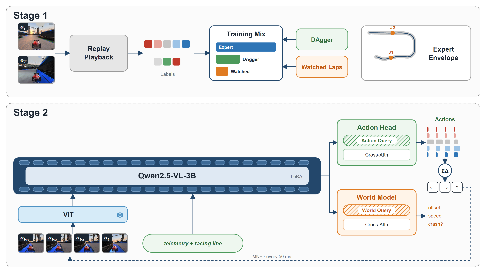

# trackvla

A vision-language-action model that drives TrackMania Nations Forever. It sees the game through its camera, reads the car's telemetry, and outputs steering and throttle. It was trained only by imitating 300 expert replays, with no reinforcement learning.

<table>
  <tr>
    <th align="center">Fast</th>
    <th align="center">Safe</th>
  </tr>
  <tr>
    <td></td>
    <td></td>
  </tr>
  <tr>
    <td align="center">24.6 s lap</td>
    <td align="center">35.9 s lap, on the experts' line through both jumps</td>
  </tr>
</table>

## Architecture

### Stage 1: data

Public A01 replays from TMNF Exchange are played back through TMInterface. The game is deterministic, so each replay reproduces exactly, and it pauses every 50 ms so a 160x120 frame and the car's telemetry can be recorded. That gives 300 expert laps without anyone driving them.

Each frame is labelled with what the expert did next: how much they steered over the following 250 ms (5 levels, full left to full right) and whether they were on the gas, coasting or braking. Two more sources are mixed into training:

- **DAgger laps**: the model drives, and an automatic expert (a racing-line follower or a nearest-neighbour lookup over the expert laps) labels every frame with what it should have done.
- **Watched laps**: recorded laps of the model itself, crashes included, used only to teach the world model what happens next.

### Stage 2: policy

- **Inputs**: the last 4 frames, 100 ms apart, and a line of text with the telemetry and the car's position relative to the experts' racing line.
- **Vision encoder**: Qwen2.5-VL's ViT turns each frame into about 108 tokens. It stays frozen.
- **Language model**: Qwen2.5-VL-3B reads the image and text tokens together. Only LoRA adapters (rank 16, about 11M parameters) are trained.
- **Action head**: 4 learned queries cross-attend over the model's tokens and predict steering and throttle for each of the next four 50 ms steps.
- **World model head**: 1 learned query predicts the sideways offset and speed 1 and 2 seconds ahead, and whether the lap is about to fail. It is only used during training, to push the shared weights toward understanding the car's motion.

### Driving

The model replans every 50 ms. Its overlapping 200 ms plans are averaged, steering amounts below 0.2 are treated as straight, and a sigma-delta modulator turns the rest into 50 ms key taps. The game pauses while the model plans, so a lap runs slower than real time, but every decision is made on the current frame.

## Results

- Finishes about half of its solo laps on A01, with a best lap of 24.6 s.
- The v3 model clears jump 1 and the checkpoint ring in 20 of 20 laps.
- 64% of laps that reach checkpoint 2 go on to finish.

### Why laps fail: the two jumps

A01 is 2.2 km long, and every failed lap ends at one of its two jumps. Over 20 laps of the best model, 4 of the 10 failures happened at jump 1 or its landing (between 290 m and 660 m) and the other 6 at jump 2 (between 1,780 m and 2,020 m). The rest of the track, every corner and straight in between, never ended a lap.

- **Jump 1** needs a straight, centred take-off. Early models drifted a few metres off the line on the approach and landed crooked. Telling the model its offset from the experts' line (v3) fixed this: 20 of 20 laps got through.
- **Jump 2** needs speed. The experts take off at about 480 km/h; every model reaches it at 310 to 345 km/h, lands short and falls below the track, even when it is perfectly lined up. The speed is lost in the corner before the jump, where the model steers more than the experts and every steering tap scrubs speed. The expert laps never show how to recover lost speed, so imitation alone cannot teach it.
